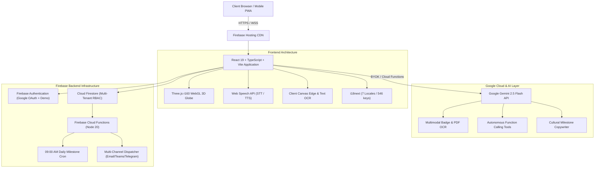

# 🏆 Google Cloud AI Builder Cup 2026 — Official Submission Q&A

> **Project Name**: HRChronicle AI  
> **Tagline**: Intelligent HR Annual Date Notifications & Multilingual Workforce Copilot  
> **Live Production App**: [https://myanmardev.web.app](https://myanmardev.web.app)  
> **GitHub Repository**: [https://github.com/vibecode-ting/hr_chronicle_ai](https://github.com/vibecode-ting/hr_chronicle_ai)  
> **Official Presentation Deck**: [HR_Chronicle_AI_Builder_Cup_2026_Submission.pdf](./HR_Chronicle_AI_Builder_Cup_2026_Submission.pdf)  
> **Demo Video Link**: `https://youtu.be/YOUR_DEMO_VIDEO_ID` *(Replace with final upload link)*  

---

## 1. Project Overview & Pitch

### What is the one-line pitch of your project?
*HRChronicle AI is a cloud-native, multi-tenant workforce intelligence platform powered by Google Gemini 2.5 Flash and Three.js, automating milestone celebrations, multimodal badge OCR onboarding, and multilingual employee operations across 34 Asia Pacific territories.*

### Provide a short description (under 200 words)
*Hybrid and cross-border organizations across Asia Pacific struggle with scattered employee rosters, cultural celebration disconnects, and heavy administrative overhead. Critical work anniversaries and birthdays are trapped in badge photos, paper files, or disparate spreadsheets.*

*HRChronicle AI solves this by combining multimodal Google Gemini 2.5 Flash intelligence, interactive 3D WebGL JAPAC globe visualization, and automated Firebase Cloud Functions into an enterprise-grade platform. Features include an autonomous Universal HR Copilot with voice STT/TTS and function-calling tools, multimodal vision OCR roster import, a GenAI Celebration Card Studio producing 1200x630 branded graphics, 1-click sandbox Product-Led Growth (PLG) tier switching, multi-currency OCR mobile wallet checkout (KBZ Pay, Wave Pay), and complete 100% dictionary parity across 7 Asian business languages.*

---

## 2. Inspiration

### What inspired you to build HRChronicle AI?
*Managing workforce milestones across the Asia Pacific region presents unique operational, linguistic, and cultural complexities that conventional Western HR tools fail to address:*

1. **Scattered & Unstructured Roster Data**: Small and medium enterprises across Southeast and East Asia still track personnel milestones on paper badges, mobile phone photos, and localized spreadsheets. Manual data entry leads to frequent oversights.
2. **Cultural Tone & Language Nuance**: A standard English "Happy Work Anniversary" email feels sterile and culturally tone-deaf when celebrating a milestone in Japan, Myanmar, Vietnam, or China. Honorific conventions, tenure reverence, and regional warmth require native-level cultural nuance.
3. **Fragmented Communication Channels**: In Asia, workplace announcements do not live exclusively in corporate Outlook inboxes — teams coordinate dynamically across Telegram, Microsoft Teams, and localized chat applications.
4. **Friction in Regional Payment Adoption**: Traditional SaaS platforms enforce credit-card-only subscriptions in USD, alienating regional teams who rely on local QR-based mobile wallets like Myanmar's KBZ Pay or Wave Pay.

*We set out to build an end-to-end, culturally resonant platform that leverages Google Cloud’s state-of-the-art Gemini 2.5 Flash multimodal models and WebGL spatial graphics to make every employee milestone visible, celebrated, and memorable.*

---

## 3. What It Does (Detailed Capabilities)

### 🌍 1. Interactive 3D JAPAC Earth Network (`public/earth.html`)
- **34 Economic Nodes**: Features an interactive 3D WebGL globe created with Three.js r160, highlighting 34 JAPAC countries and territories.
- **Atmospheric Sunrise Shaders**: Custom GLSL vertex and fragment shaders render realistic atmospheric scattering, day/night terminators, and directional sun illumination.
- **Great-Circle SLERP Flight Arcs**: Regional office nodes connect to the central Singapore hub using spherical linear interpolation with sinusoidal elevation ($1.6 - 4.8$ units) ensuring arcs never clip through the planet surface.
- **Front-Facing Illumination**: Camera-anchored directional lighting (`cameraLight`) ensures Pacific island territories (Fiji, Kiribati, Samoa, New Zealand) remain textured and visually distinct without dark shadows.

### 🤖 2. Universal AI HR Copilot (`gemini-2.5-flash`)
- **Multimodal Vision OCR Import**: Drop or capture photo badges, PDF roster tables, or employee ID cards. Gemini 2.5 Flash Vision parses noisy documents into structured JSON (`name`, `department`, `role`, `birthday`, `startDate`) for instant onboarding.
- **Autonomous Tool-Based Function Calling**: Copilot autonomously triggers tenant tools:
  - `searchEmployees`: Search by name, department, or location.
  - `getUpcomingMilestones`: Identify impending birthdays and anniversaries within 7–90 days.
  - `getDepartmentHeadcount`: Summarize headcount breakdown by organizational unit.
  - `addEmployee` & `deleteEmployee`: Controlled roster mutations.
- **2-Step Database Mutation Safeguards**: Every destructive action proposed by the Copilot triggers an interactive confirmation modal. No records write to Cloud Firestore without explicit human sign-off.
- **Web Speech API Dictation & Audio Readouts**: Fully integrated voice-to-text dictation (`SpeechRecognition`) and multilingual speech synthesis playback (`SpeechSynthesis`).

### ✨ 3. GenAI Celebration Card Studio (`src/components/milestones/AiCardStudioModal.tsx`)
- **Culturally Attuned Copywriting**: Gemini Flash drafts warm, localized congratulatory copy factoring in tenure milestones, employee achievement, and regional cultural etiquette.
- **1200x630 Branded PNG Canvas Rendering**: Automatically composites company branding, employee avatar, celebratory graphics, and localized copy onto an exportable canvas card.
- **Omnichannel Dispatch Engine**: One-click or scheduled automated distribution across SMTP Email, Microsoft Teams webhook channels, and Telegram announcement bots.

### 🎨 4. Product-Led Growth (PLG) & Sandbox Demo Mode
- **1-Click Sandbox Tier Simulation**: Evaluators can instantly switch between **Free (Starter)**, **Pro (Growth)**, and **Ultra (Enterprise)** tiers directly in the UI without entering payment credentials.
- **Dynamic Schema Customization**: Allows teams to dynamically define custom roster fields on the fly:
  - *T-Shirt Size* (team anniversary swag sizing)
  - *Dietary Preferences* (milestone celebration catering)
  - *Gift Budget ($USD)* (autonomous budget tracking)
  - *Emergency Contacts* (workforce safety records)
- **Enterprise DB Connectors**: Pre-wired connectors for PostgreSQL, MySQL, Supabase, MongoDB, and Microsoft SQL Server.

### 💳 5. Multi-Currency Pricing & Client-Side OCR Checkout (`src/views/Pricing.tsx`)
- **Regional & Global Currencies**: USD, MMK, EUR, SGD, THB, and Crypto with live conversion rates.
- **Myanmar Local Wallets**: Direct checkout flows for KBZ Pay, Wave Pay, AYA Pay, and CB Pay featuring dynamic payment QR codes and a 5-minute reservation countdown timer.
- **Client-Side Canvas Payment Slip OCR**: Scans uploaded transaction screenshots directly in the browser to verify Transaction IDs, recipient accounts, and transfer amounts before approving subscription requests.

### 📊 6. BigQuery HR Analytics & Forecasting (`src/views/Analytics.tsx`)
- **30-Day Milestone Radar**: Predictive milestone coverage and upcoming fiscal celebration schedules calibrated across 34 JAPAC nodes.
- **Tenure Cohort & Retention Risk Heatmap**: Evaluates engagement scores, tenure milestones, and turnover vulnerability across employee cohorts (Low, Medium, High).
- **Language Telemetry**: Real-time breakdown of active workforce locales and regional adoption.

### 🛡️ 7. Enterprise Admin Control Center (`src/views/AdminDashboard.tsx`, `AdminUsers.tsx`)
- **System Announcement Banners**: Superadmins can broadcast real-time announcement banners across all active tenant sessions with reactivation and dismissal tracking.
- **Feedback & Diagnostic Telemetry Review**: Feedback modal captures attached client telemetry (browser user agent, viewport resolution, URL path, timestamp).
- **Multi-Tenant User Quota Audit**: Inspect user employee counts, trigger >80% quota alerts, update roles, and suspend/reactivate accounts.

### 🌐 8. 100% Multilingual Parity (7 JAPAC Locales)
- Complete dictionary parity (546 keys per language) with **zero missing keys or UI fallbacks**:
  - 🇺🇸 **English (`en`)**
  - 🇲🇲 **Myanmar (`mm`)** — မြန်မာ
  - 🇨🇳 **Simplified Chinese (`zh`)** — 简体中文
  - 🇭🇰 **Traditional Chinese / HK (`zh-HK`)** — 繁體中文（香港）
  - 🇯🇵 **Japanese (`ja`)** — 日本語
  - 🇰🇷 **Korean (`ko`)** — 한국어
  - 🇻🇳 **Vietnamese (`vn`)** — Tiếng Việt

---

## 4. How We Built It (Architecture & Stack)

### Technology Breakdown

| Component | Technology | Rationale |
|---|---|---|
| **UI Framework** | React 19.0 + TypeScript 5.8 | Reactive state primitives, strict type guarantees across enterprise schemas |
| **Styling** | Tailwind CSS v4 (`@tailwindcss/vite`) | Ultra-light theme compiler with glassmorphism tokens & dark/light contrast parity |
| **Bundler** | Vite 6.4 + Rollup `manualChunks` | Sub-5 second builds, isolated vendor splits (`vendor-firebase`, `vendor-recharts`, `vendor-xlsx`) |
| **3D WebGL** | Three.js r160 | Custom GLSL shaders, camera-anchored lighting, quaternion SLERP flight trajectories |
| **AI Foundation** | Google Gemini 2.5 Flash (`gemini-2.5-flash`) | Industry-leading multimodal speed, token efficiency, tool calling, and vision OCR |
| **Voice / Speech** | Web Speech API | Bidirectional client-side voice dictation (`SpeechRecognition`) and audio speech playback |
| **Persistence** | Firebase Cloud Firestore | Multi-tenant security rules, real-time listeners for superadmin announcement banners |
| **Authentication** | Firebase Auth | Secure Google OAuth provider + instantaneous zero-credential demo session generation |
| **Scheduler & Cloud**| Firebase Cloud Functions (Node 20) | Automated 09:00 AM daily cron job querying upcoming milestones and dispatching alerts |
| **Spreadsheet Engine** | SheetJS (`xlsx` 0.18.5) | Client-side Excel & CSV batch roster import and export |

---

## 5. Challenges We Ran Into

### 1. WebGL 3D Earth Lighting & Trajectory Precision
- *The Problem*: Rendering 34 Asian countries on a 3D Three.js sphere initially suffered from dark void spots on Pacific island territories (Fiji, Kiribati, New Zealand) when directional sunlight rotated away. Additionally, simple quadratic Bézier curves clipped through the globe's curvature on long distances (e.g. Tokyo to Auckland).
- *Our Solution*: We implemented camera-anchored directional lighting (`cameraLight`) that moves dynamically with the viewport, ensuring all regional islands remain textured. For flight arcs, we engineered spherical linear interpolation (SLERP) with sinusoidal elevation ($1.6 - 4.8$ units above the sphere surface), guaranteeing that trajectories never penetrate the globe mesh.

### 2. Dual-Mode Generative AI & Demo Offline Safety
- *The Problem*: In hackathon and production demo environments, network dropouts or exhausted API rate limits can break generative demos.
- *Our Solution*: We architected a dual-mode AI engine. Users can supply their own Google Gemini API key or use our cloud backend. Crucially, every AI generative tool (card copywriting, badge OCR, function calling) is backed by high-fidelity localized fallback templates. If the network or API is offline, the app degrades gracefully with zero UI errors or crashes.

### 3. Absolute Parity Across 7 Asian Locales (546 Keys)
- *The Problem*: Complex enterprise web applications often suffer from "untranslated UI leaks" where modals, placeholders, or error alerts display fallback English text in non-English locales.
- *Our Solution*: We built a strict dictionary parity pipeline. Every single view, modal, input placeholder, badge, and tooltip is governed by 546 localized dictionary keys across English, Myanmar, Simplified Chinese, Traditional Chinese / HK, Japanese, Korean, and Vietnamese.

### 4. Enterprise Safety in Agentic Function Calling
- *The Problem*: Allowing an autonomous LLM copilot to execute mutations (like deleting an employee or altering anniversary records) poses serious data governance risks.
- *Our Solution*: We introduced **2-Step Database Mutation Safeguards**. When Gemini 2.5 Flash decides to invoke `addEmployee` or `deleteEmployee`, the Copilot does not write directly to Firestore. Instead, it generates a staged confirmation card in the chat interface. The write transaction executes only when the human operator explicitly clicks "Confirm Mutation".

---

## 6. Accomplishments We're Proud Of

1. **Sub-5-Second Build & Lightweight Main Chunk**: Optimized bundle splitting via Rollup manual chunks, isolating Firebase, Recharts, and SheetJS. The main application entry chunk is optimized to just **366 kB** (112 kB gzip).
2. **Instant Sandbox Demo Experience**: Judges and users can experience every enterprise feature (Free, Pro, Ultra, Admin) with **one click** on `https://myanmardev.web.app/login` without creating an account or supplying a credit card.
3. **Flawless High-Contrast Dark & Light Theming**: Fully accessible WCAG-compliant styling across both dark glassmorphism and crisp solid light modes across all 39 verified screens.
4. **End-to-End Multimodal Vision & Speech**: Seamless fusion of voice dictation (STT), multilingual speech playback (TTS), and Gemini 2.5 Flash Vision OCR badge extraction in a unified assistant.

---

## 7. What We Learned

- **Gemini Flash is an Operational Workhorse**: Google Gemini 2.5 Flash offers the ideal combination of low latency, high token economy, and exceptional multimodal reasoning, making it exceptionally well-suited for high-frequency interactive HR tools.
- **Spatial UI Drives Enterprise Empathy**: Visualizing cross-border teams on a 3D globe fundamentally changes how leaders perceive organizational connectivity compared to a flat spreadsheet row.
- **Cultural Localization Goes Beyond Text Translation**: Adapting an enterprise product for JAPAC requires honoring local honorifics, regional mobile payment workflows (KBZ Pay/Wave Pay), and localized communication channels (Telegram/Teams).

---

## 8. What's Next for HRChronicle AI

- **Enterprise HRIS Connectors**: Native bi-directional sync with Workday, BambooHR, and SAP SuccessFactors.
- **Autonomous WhatsApp & WeChat Corporate Bots**: Expanding multi-channel notification dispatch to WhatsApp Business API and WeChat Enterprise.
- **Predictive Retention Mitigation via BigQuery ML**: Machine learning models predicting turnover risk based on tenure plateau thresholds, automatically recommending tailored retention incentives.
- **Automated Milestone Gift Fulfilment**: Regional e-commerce API integrations (GrabGifts, Shopee, Lazada) for automated zero-touch anniversary gift delivery.

---

## 9. Google Cloud Technologies Used

| Technology | Role & Integration in HRChronicle AI |
|---|---|
| **Google Gemini 2.5 Flash** | Multimodal Vision OCR badge parsing, tool-based function calling, cultural milestone copywriting |
| **Firebase Hosting** | Global edge CDN production deployment serving `https://myanmardev.web.app` |
| **Firebase Cloud Functions (Node 20)** | Automated 09:00 AM daily milestone scheduler & omnichannel notification dispatcher |
| **Cloud Firestore** | Multi-tenant NoSQL database with granular role-based security rules |
| **Firebase Authentication** | Enterprise Google OAuth provider & instant demo session generator |
| **Google Cloud Storage** | Persistent storage for rendered 1200x630 celebration card assets and telemetry diagnostics |

---

## 10. Links & Deliverables

- 🌐 **Live Web Application**: [https://myanmardev.web.app](https://myanmardev.web.app)
- 💻 **GitHub Repository**: [https://github.com/vibecode-ting/hr_chronicle_ai](https://github.com/vibecode-ting/hr_chronicle_ai)
- 📑 **Presentation Deck**: [HR_Chronicle_AI_Builder_Cup_2026_Submission.pdf](./HR_Chronicle_AI_Builder_Cup_2026_Submission.pdf)
- 🎬 **Video Script & Prompt**: [demo_video_script.md](./demo_video_script.md)
- 📸 **Application Screenshots**: 39 visual captures in `/screenshots/`
